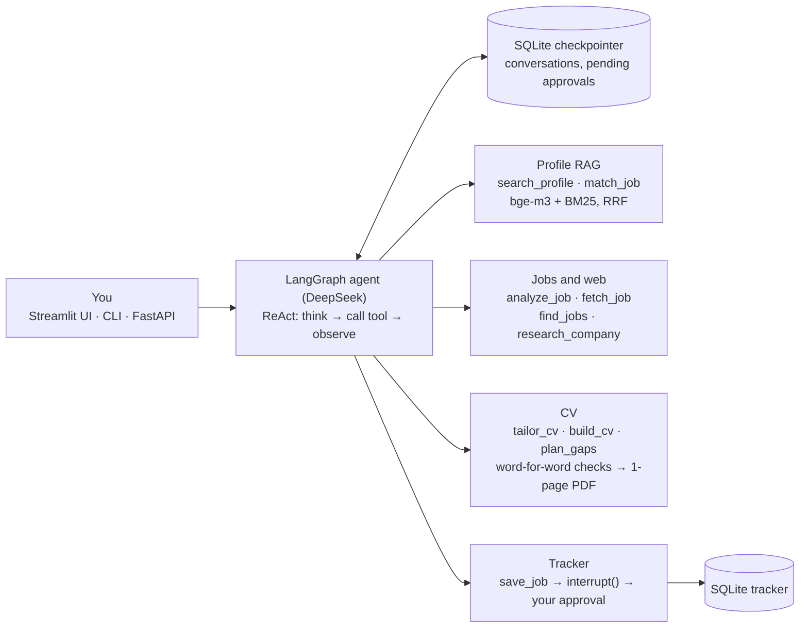

# Job Agent

An AI agent that matches job descriptions to your profile, tailors your CV with cited evidence,
and tracks your applications. Built with **LangChain** (RAG) and **LangGraph** (agent).
Works with Chinese and English job postings.



## What makes it more than a demo

| Problem | Solution |
| --- | --- |
| Dense search misses exact terms ("LoRA", "PyTorch", "评测") | **Hybrid retrieval**: Chroma vectors + BM25, merged with Reciprocal Rank Fusion |
| Chinese has no spaces, so word-based search and chunking fail | Chinese-aware splitter (breaks at 。！？) and character-bigram BM25 tokens |
| LLM output is free text and breaks parsers | **Structured outputs** with Pydantic schemas |
| Requirements alone miss what the job actually involves | Responsibilities are matched too: must-have ×2, responsibility ×1.5, preferred ×1 |
| LLMs flatter and invent experience | Code-enforced grounding: "strong" needs a real citation; a CV bullet needs evidence and must target a real job item |
| Output drifts into the CV's language | CV bullets are written in the posting's language (detected during analysis) |
| Agents can take wrong actions | **Human-in-the-loop**: `save_job` pauses the graph (`interrupt`) until you approve |
| Agents can loop | Step limit per message (`MAX_STEPS`) |
| A restart loses the conversation | **SQLite checkpointer** (`SqliteSaver`): chats and a waiting approval continue after a restart |
| A failing tool crashes the turn | `ToolNode(handle_tool_errors=…)`: errors go back to the model, invalid arguments (Pydantic) can be corrected |
| Networks drop, APIs rate-limit | Retries with exponential backoff for timeouts, connection errors, 429 and 5xx; wrong keys fail at once |
| Same job pasted twice costs twice | Job id = hash of the text; repeated analysis is served from cache |
| Hard to change safely | Offline tests with a scripted fake model + CI on every push |

## Project layout

| File | What it does |
| --- | --- |
| `jobagent/rag.py` | Load PDFs/notes, split, index (Chroma + BM25), hybrid search |
| `jobagent/schemas.py` | Pydantic schemas for structured outputs |
| `jobagent/tools.py` | The ten tools and their grounding rules |
| `jobagent/agent.py` | LangGraph graph, checkpointer, `step()` with interrupt handling |
| `jobagent/store.py` | Job drafts and reports (JSON files), the tracker (SQLite) |
| `jobagent/cvdoc.py` | Finds your CV, photo and logo; word-for-word, number, language and length checks; Word copy |
| `jobagent/cvpdf.py` | One-page PDF CV with Typst |
| `cv_preferences.md` | Your standing CV rules, read by `build_cv` |
| `jobagent/web.py` | Reads job pages from links (headless browser for JavaScript pages); web search (Baidu, Bocha or Tavily) |
| `login.py` | Optional: log in to job sites once in the app's browser; only cookies are saved |
| `jobagent/evaluation.py` | Blind label sheet, agreement metrics, evaluation report |
| `evaluate.py` | Runs the judge evaluation and keeps a history of versions |
| `rematch.py` | Re-runs matching on all analyzed jobs with the current judge |
| `jobagent/api.py` | HTTP API (FastAPI): chat, approvals, tracker, jobs |
| `jobagent/agent_eval.py` | Routing accuracy and retrieval hit-rate evaluation |
| `evaluate_agent.py` | Runs those two evaluations (`eval/routing_cases.csv`, `eval/retrieval_cases.csv`) |
| `jobagent/stats.py` | Paired significance tests: McNemar, bootstrap CIs, sign test, weighted kappa |
| `jobagent/analytics.py`, `analytics.py` | Application funnel, CV A/B test, job segments (clustering) |
| `jobagent/cv_eval.py`, `evaluate_cv.py` | Quality evaluation of the generated CVs (blind A/B, LLM judge, agreement) |
| `export_openapi.py`, `integrations/DIFY.md` | Use the API as a tool in Dify or Coze |
| `app.py` | Web UI (Streamlit) |
| `cli.py` | Terminal chat |
| `ingest.py` | Indexes `profile/` |
| `tests/` | End-to-end tests with fake models (no API cost) |

## Setup

```bash
python -m venv .venv
source .venv/bin/activate          # Windows: .venv\Scripts\activate
pip install -r requirements.txt
cp .env.example .env               # then put your DeepSeek or Qwen key in .env
mkdir profile                      # put your CV (PDF), papers, and a projects.md here
python ingest.py
```

## Use

```bash
streamlit run app.py              # web UI
python cli.py                     # or the terminal (/job to paste a posting, /jobs for the tracker)
uvicorn jobagent.api:app          # or the HTTP API; docs at http://localhost:8000/docs
pytest                            # tests, offline and free
```

Conversations are saved in `data/checkpoints.sqlite`: after a restart the app reopens your last
conversation, including an approval that was still waiting.

### HTTP API

| Method | Path | What it does |
| --- | --- | --- |
| POST | `/chat` | Send a message (`{"message": "...", "thread_id": "..."}`; no id = new conversation) |
| POST | `/chat/{thread_id}/approval` | Answer a waiting approval (`{"approve": true}`) |
| GET | `/chat/{thread_id}` | The conversation and any waiting approval |
| GET | `/applications` | The tracker |
| DELETE | `/applications/{job_id}` | Remove a job from the tracker |
| GET | `/jobs/{job_id}` | A job's analysis and match |

The API and the UI share the same agent, checkpointer and tracker.

Try:
- *paste a job description* → analysis, match score, strengths and gaps
- "Prepare my CV for this job" → tailored bullets, each citing your own documents
- "Save it as applied" → approval card → tracker
- "Which of my projects show evaluation experience?" → answered from your profile with sources

Reports are saved in `data/reports/`. The matcher only finds what is written down,
so add skills and projects that are not on your CV to `profile/projects.md`.

## Full tailored CV and gap plan

- **"Make me a CV for this job"** (or "...in Chinese") → `build_cv` makes a **one-page PDF** in the
  style of your own CV (logo, photo, ruled section titles, dates on the right, skills table), plus an
  editable Word copy. Both appear as download buttons in the chat.
  1. **Tailor**: reorders sections, entries and bullets so the most relevant come first, shortens the
     objective, and may leave out irrelevant project bullets. **Bullets stay word for word.**
  2. **Self-review → revise**: a second pass checks the draft against your original CV.
  3. **Code checks** (not just prompts): words added to your bullets are removed (e.g. "（并发）"),
     invented lines are dropped, numbers must exist in your CV, and no language may be removed.
     A translated CV skips the word-for-word check and says so.
  4. **Order and honesty**: entries are put back newest-first like your CV, and the reply says whether the
     objective really changed (checked in code, so the agent cannot claim changes that did not happen).
  5. **One page**: the PDF layout shrinks step by step until it fits (Typst, no Word/WPS needed).
  Your standing rules live in `cv_preferences.md` (e.g. "keep Korean"); edit it in your own words.
  Photo and logo are taken from your CV PDF, or put `photo.jpg` / `logo.png` in `profile/`.
  Optional: `CV_MODEL=deepseek-v4-pro` in `.env` uses a stronger model only for writing the CV.
- **"How can I close my gaps?"** → `plan_gaps`: one action per partial/missing item (add evidence,
  reframe, build, learn) with effort and proof. Only write down what really happened.

## Web: find jobs, job links and employer research

- **"Find LLM evaluation jobs in Shanghai for 2027 graduates"** → `find_jobs`:
  1. plans 3 searches with words found on posting pages (岗位职责, 任职要求, 27届) and different role names;
     searches run **only on job sites** (`JOB_SITES`, last 6 months), plus one open-web search if they return little;
  2. an LLM keeps only results that are ONE open, relevant posting (no blogs, 面经, lists, closed jobs);
     city, graduation year and experienced-hire roles (3-5年) are preferences, not rejections;
     code also skips "已截止"/expired postings, past deadlines, pages with no job on them, and jobs you already have;
  3. reads the best ones (default 3, at most 5) and matches each against your CV with the RAG matcher;
     if a page can't be opened but the search summary is long, it matches the summary and marks the score with *;
  4. returns a ranked shortlist with match score and link, saved in `data/reports/search-<date>-jobs.md`.
  Nothing is added to the tracker: say "save #1" for the ones you want.
  Cost: about 3 searches plus roughly 15 model calls per posting read (3-8 minutes for 5 postings).
  Limits: web search rarely indexes company campus sites (2027届 roles), and BOSS直聘 blocks automated
  browsers. For real applications, pasting a link from a campus site works best.

- **Paste a link** to a posting → `fetch_job` reads the page and analyzes it; the link is saved with the job.
  Some career sites (e.g. Huawei's) build the page with JavaScript; then either paste the text, or install
  the optional browser: `pip install playwright` and `playwright install chromium`.
  Sites that need a login: run `python login.py` once and log in yourself in the window that opens;
  the cookies stay in `data/browser/` (delete it to log out). Your password is never stored.
- **"Research this company/team"** → `research_company` runs 2-3 web searches, then writes a brief
  (overview, recent news, what to emphasize, questions to ask). Every point cites a numbered source;
  points without a real source are removed. The "emphasize" topics also guide `build_cv`, never as claims.
  Set `SEARCH_PROVIDER` and `SEARCH_API_KEY` in `.env`: Baidu (百度 via Qianfan 千帆, daily free quota,
  give the key only the 千帆 permissions it needs), Bocha (博查, open.bochaai.com), or Tavily (free tier,
  may need a VPN from China).

## Tracker

Saved jobs live in a SQLite database (`data/tracker.sqlite`; an older `tracker.json` is moved in
automatically). Each saved job keeps: company, title, match score, status, **saved date**, **applied date**,
deadline (if the posting gives one) and the **link** to the posting. Dates are kept when the status
changes later. Say for example "save it, here is the link: https://…" or "I applied, update it".

## Evaluate the judge

How often does the LLM judge agree with you?

```bash
python evaluate.py export      # writes eval/labels.csv; judge verdicts are hidden so they don't bias you
# open it in Excel, fill `your_label` with s / p / m (strong / partial / missing), save as CSV UTF-8
python evaluate.py report v1   # -> eval/report-v1.md + a row in eval/history.csv
```

Improve and measure again, without re-labeling (the job items stay the same):

```bash
python rematch.py --no-expansion --top-k 3   # only the stricter judge
python evaluate.py report v2-rubric
python rematch.py                            # + query expansion, top-5 evidence
python evaluate.py report v3-retrieval
```

### Results so far

| Version | Agreement | Kappa | Too generous | What changed |
| --- | --- | --- | --- | --- |
| v1 | 74.5% | 0.62 | 16% | baseline (55 items, 4 jobs) |
| v2-rubric | 83.6% | 0.75 | | stricter rubric, "partial needs a citation" in code |
| v3-retrieval | 85.5% | 0.78 | | + query expansion, top-5 evidence |

Failure analysis of v1: (1) the judge used "partial" even when its own reason said "no evidence";
(2) a retrieval miss: "deep learning frameworks" did not retrieve the skills line naming PyTorch;
(3) responsibilities had the lowest agreement (59%), because they combine several tasks.
Fixes: a stricter rubric plus "partial needs a citation" in code; query expansion with top-5
evidence; compound responsibilities are now split into separate items (new jobs only, so the
labels stay valid). Reference labels were drafted with a second LLM and reviewed by the author.

The report gives agreement, Cohen's kappa, a confusion matrix, whether the judge is too generous
or too strict, results per item type, judge-vs-you match scores, and every disagreement.
Label ~50 items (3-4 matched jobs) for a meaningful result.

## Evaluate routing and retrieval

```bash
python evaluate_agent.py routing v1     # 路由准确率: does the agent pick the right first tool?
python evaluate_agent.py retrieval v1   # 检索命中率: recall@5, hit@5, MRR for BM25, dense, hybrid
```

- **Routing**: 41 test messages in Chinese and English (`eval/routing_cases.csv`), each with the tool
  the agent should call first, or `none` when it should just answer or ask. Only the first model call
  is made and no tool runs, so a run costs 41 small calls and changes nothing.
- **Retrieval**: 20 queries (`eval/retrieval_cases.csv`), each with key phrases; a profile chunk is
  relevant when it contains one, so the labels survive re-chunking. The same queries run through
  BM25 alone, bge-m3 alone and the hybrid. With a small profile (a one-page CV is ~4 chunks) the
  top 5 holds almost everything and the report warns that the numbers say little: add more material
  to `profile/` first.

Both add rows to `eval/agent_history.csv`, so versions can be compared.

Results so far (deepseek-flash): routing 97.4% (v1) → 100% (v2, after one prompt fix, on the same 38
cases); retrieval on 28 queries over 15 chunks: recall@5 BM25 83.3%, bge-m3 74.3%, **hybrid 88.6%**
(MRR 0.93 / 0.94 / **1.00**).

## Is the new version really better? (significance tests)

A higher number on a small test set can be chance. Both comparisons are paired (same items):

```bash
python evaluate.py compare v1 v3            # judge versions: McNemar exact test + bootstrap 95% CIs
python evaluate_agent.py compare v1 v2      # routing versions: the same
```

McNemar counts the items only one version got right; the bootstrap gives a 95% interval for the
difference in accuracy (and in kappa). Each run is saved per item in `eval/runs/`; for older runs the
results are rebuilt from the reports. Example: routing v1 → v2 fixed 1 case and broke 0, p = 1.0, so
on 38 cases it is not evidence of a real improvement on its own.

## Job-search analytics (funnel, A/B test, segments)

```bash
python analytics.py        # also in the app's sidebar (📊 Analytics) and at GET /analytics
```

- **Funnel**: saved → applied → interview → offer, with conversion between stages. A rejection keeps
  the furthest stage reached. Tell the app about progress: "我拿到了面试", "I got rejected".
- **Response rate by channel**: campus site, BOSS直聘, referral… ("I applied through a referral").
- **A/B test**: tailored CV vs original CV, response rate (reached interview) with Fisher's exact test.
  Not randomized (you choose which jobs get a tailored CV), and the report says so.
- **Segments**: analyzed postings clustered by duties and must-haves (TF-IDF + k-means++), each
  named by its top terms, with average match score and response rate per segment.

## Generated CV quality (AIGC evaluation)

```bash
python evaluate_cv.py export      # blind sheet: each job's original and tailored CV as A/B, random order
python evaluate_cv.py report v1   # LLM judge rubric scores + your ratings
```

Both CVs are scored for the job (relevance, clarity 1-5): by an LLM judge with a rubric, and by you
without knowing which one is tailored. The report gives the A/B result (does tailoring help? sign
test), judge-vs-you agreement (exact, within one point, quadratic-weighted kappa) and the badcases:
jobs where the tailored CV scored lower, or where the judge and you differ by 2+ points.
Faithfulness is not scored: build_cv's code checks already guarantee it.

## Dify / Coze

`python export_openapi.py` writes the API description that Dify or Coze import as a custom tool;
see [integrations/DIFY.md](integrations/DIFY.md).

## Cost

Embeddings and search run locally (free). An agent turn uses a few DeepSeek calls:
analysis is 1 call, matching is 1 call per requirement (≤ 12), CV tailoring is 1 call.

## Roadmap

**Evaluation layer**
- ✅ Judge vs human agreement (`evaluate.py`)
- ✅ Retrieval: recall@k for dense vs BM25 vs hybrid (`evaluate_agent.py retrieval`)
- ✅ Agent routing: right first tool (`evaluate_agent.py routing`)
- ✅ Paired significance tests for version comparisons (`compare`)
- ✅ Generated CV quality: blind A/B, LLM judge, agreement (`evaluate_cv.py`)
- Agent: full tool sequences and task success over repeated runs
- Trace latency, tokens and cost per turn

**Web**
- ✅ `fetch_job` and `research_company`
- ✅ Job discovery on job sites (`find_jobs`), for review (not auto-apply)
- Campus-site source: query company campus sites (ByteDance, Tencent, …) directly for 2027届 roles
- Faster `find_jobs`: read and match postings in parallel

**CV**
- Track self-review findings over time

**Service**
- ✅ FastAPI service, SQLite tracker, SQLite conversation memory
- ✅ Application funnel, CV A/B test, job segments (`analytics.py`)
- ✅ OpenAPI export for Dify / Coze
- MCP server exposing `search_profile` and `match_job` to other agents
